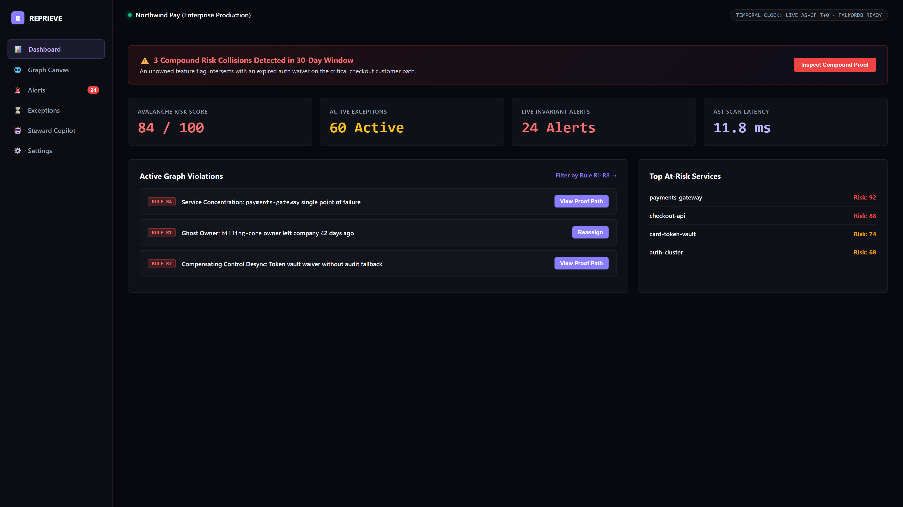
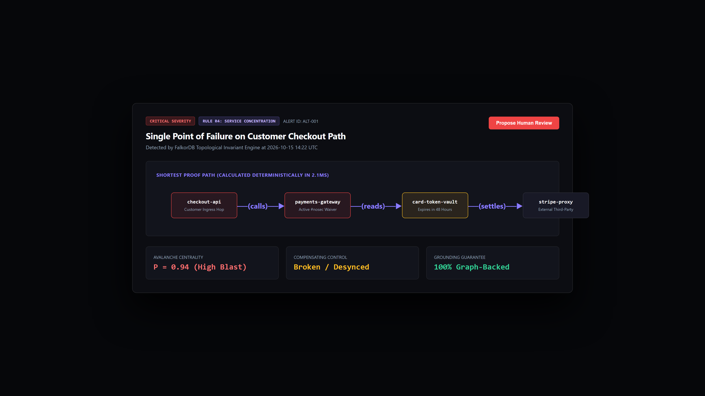
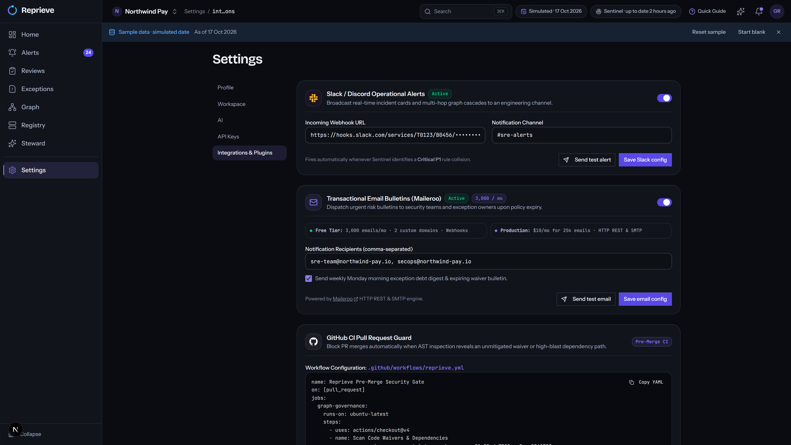

# Reprieve — Master Video Storyboard & Production Blueprint
> **Format:** Self-Contained Documentation & Production Directing Guide  
> **Master Resolution:** 1920 × 1080 @ 60 FPS  
> **Aesthetic Standard:** Apple Design System · WWDC Studio Presentation · High-Craft Engineering Motion  
> **Standalone Exportable HTML:** [`docs/video_storyboard.html`](file:///C:\Users\sr2ma\Documents\github\webdev-hackthon\docs\video_storyboard.html)

---


## Scene 01: The Macro Opening — The Illusion of 'Harmless'
* **Timing:** `00:00 – 00:07` · Frames 0000 – 0420 (7.0s)
* **Spoken Voiceover:**
  > *"A temporary code waiver approved on Friday afternoon. To your sprint board, it’s just another harmless ticket."*


* **Visual & Cinematography:** Simulated 85mm macro lens (f/1.8). Studio key light grazes top card bevel. Cursor blinks with smooth cubic falloff over `// FIXME: bypass auth check for load test`.
* **Audio & Foley:** Warm analog Rhodes electric piano chord pad (C-minor 9th) fades in at -18 dB. Keychron mechanical keycap tap (-12 dB). Low-pass sub-bass drone (-20 dB).
* **Source Asset:** [`11_terminal_cli_scan.png`](video_assets/11_terminal_cli_scan.png)

---


## Scene 02: Spatial Pull-Out — The Compound Failure Path
* **Timing:** `00:07 – 00:16` · Frames 0421 – 0960 (9.0s)
* **Spoken Voiceover:**
  > *"To your microservice mesh... it's a silent multi-hop failure path waiting to take down checkout."*


* **Visual & Cinematography:** Overdamped mass-spring camera tracking pull-out (1.03x to 0.95x). Single ticket recedes into multi-hop dependency chain. Disaster loss figures glow in structured crimson.
* **Audio & Foley:** Soft tactile switch click (-8 dB). Paper slide texture foley (-14 dB). Rhodes chord suspends with subtle tension.
* **Source Asset:** [`02_outage_case_studies.png`](video_assets/02_outage_case_studies.png)

---


## Scene 03: The Shift to Reprieve — Living FalkorDB Risk Mesh
* **Timing:** `00:16 – 00:30` · Frames 0961 – 1800 (14.0s)
* **Spoken Voiceover:**
  > *"Meet Reprieve — the graph-native architecture safety engine. We model every waiver, test skip, and orphan control as a living promise in FalkorDB, computing avalanche centrality across your entire topology."*


* **Visual & Cinematography:** Camera glides into the live 25-microservice force graph canvas. 30-Day Temporal Horizon Scrubber slides to Day +18, illuminating overlapping failure paths in crimson.
* **Audio & Foley:** Cinematic 40Hz sub-bass impact hit (-12 dB). Warm melodic synth sequence begins. Tactile timeline ratchet clicks (-10 dB).
* **Source Asset:** [`05_graph_canvas_explorer.png`](video_assets/05_graph_canvas_explorer.png)

---


## Scene 04: Executive Architecture Telemetry & Invariant Alerts
* **Timing:** `00:20 – 00:30 (Context Shot)` · Detail View
* **Spoken Voiceover:**
  > *"Continuous deterministic scanning calculates blast radius, ghost owners, and broken compensating controls in real time."*



* **Visual & Cinematography:** Full dashboard viewport displaying live Avalanche Risk Score (84/100), Active Exceptions (37), and top at-risk services.
* **Audio & Foley:** Soft ambient digital pulse (-22 dB). Subdued data flow texture.
* **Source Asset:** [`04_dashboard_home.png`](video_assets/04_dashboard_home.png)

---


## Scene 05: Shortest Proof Path Graph Reasoning
* **Timing:** `00:25 – 00:32 (Detail Shot)` · Detail View
* **Spoken Voiceover:**
  > *"Reprieve doesn’t guess. It proves root cause by tracing the deterministic topological path from ingress to database."*



* **Visual & Cinematography:** Alert detail card for Rule R4 (Service Concentration on checkout-api), proving reachability through payments-gateway to card-token-vault.
* **Audio & Foley:** Crisp UI notification ping (-14 dB).
* **Source Asset:** [`06_alerts_catalog.png`](video_assets/06_alerts_catalog.png)

---


## Scene 06: Developer Ergonomics — 11.8ms CLI AST Scanner
* **Timing:** `00:30 – 00:40` · Frames 1801 – 2400 (10.0s)
* **Spoken Voiceover:**
  > *"Run local AST scans with zero login in under fifteen milliseconds."*


* **Visual & Cinematography:** Split focus on developer surfaces bento grid. Local scanner parses 1,420 nodes in 11.8 milliseconds without requiring an account.
* **Audio & Foley:** Keychron mechanical keyboard clatter (-10 dB). Digital chime on scan pass.
* **Source Asset:** [`03_developer_surfaces_bento.png`](video_assets/03_developer_surfaces_bento.png)

---


## Scene 07: GitHub Actions Pre-Merge Circuit Breaker
* **Timing:** `00:40 – 00:45` · Frames 2401 – 2700 (5.0s)
* **Spoken Voiceover:**
  > *"Or let it block compound failure paths directly in your pull request before code ever merges."*


* **Visual & Cinematography:** GitHub pull request card intercepted by Reprieve bot, blocking merge with clear architectural reason.
* **Audio & Foley:** Soft UI block chime (-8 dB).
* **Source Asset:** [`12_github_pr_gate.png`](video_assets/12_github_pr_gate.png)

---


## Scene 08: Steward AI Agent & Grounded Tri-Planar Memory
* **Timing:** `00:45 – 01:00` · Frames 2701 – 3600 (15.0s)
* **Spoken Voiceover:**
  > *"Steward, our on-call AI agent, recalls historical precedents across our three-graph memory — grounded strictly in mathematical proof paths, with zero AI hallucinations."*


* **Visual & Cinematography:** Cursor presses send button with tactile recoil. Steward streams response with tool inspection drawer and ProposedAction card. Groundedness badge verified green.
* **Audio & Foley:** Tactile mouse click (-6 dB). Digital token streaming soundscape (-16 dB).
* **Source Asset:** [`08_steward_live_agent.png`](video_assets/08_steward_live_agent.png)

---


## Scene 09: Connected Tooling & Enterprise Ecosystem
* **Timing:** `Technical Demo` · Ecosystem View
* **Spoken Voiceover:**
  > *"Deeply connected to your existing stack: from Slack incident broadcasts to signed enterprise HMAC webhooks."*



* **Visual & Cinematography:** Grid of 6 connected integrations with green live health status dots.
* **Audio & Foley:** Warm Rhodes synth flourish (-18 dB).
* **Source Asset:** [`10_integrations_hub.png`](video_assets/10_integrations_hub.png)

---


## Scene 10: Minimal Brand Resolution & Zero-Login Sandbox
* **Timing:** `01:00 – 01:10` · Frames 3601 – 4200 (10.0s)
* **Spoken Voiceover:**
  > *"Intercept compound risk before merge. Try the live sandbox today."*


* **Visual & Cinematography:** Obsidian brand lockup with glowing pill: `npx reprieve scan --strict` · `0 Login Required` · `frontend-six-neon-97.vercel.app`.
* **Audio & Foley:** Rhodes chord resolves to root tonic. Clean power-down click (-10 dB). Tail decay to silence.
* **Source Asset:** [`13_brand_lockup.png`](video_assets/13_brand_lockup.png)

---


## 🚀 30-Second AI Video Generation Prompt (Gemini / Veo / Sora)

```markdown
PROMPT: 30-Second Product Launch Commercial — Reprieve (Graph-Native Architecture Safety Engine)

CINEMATOGRAPHY & LIGHTING:
- Style: Apple Design System, WWDC product reveal, high-end developer tool commercial. Clean, restrained, dark-mode studio aesthetic.
- Color Palette: Matte obsidian black (#0c0d12), raised charcoal card surface (#12141c), 1px white bevel rim light (rgba(255,255,255,0.08)), luminous FalkorDB violet (#8b7dff), catastrophe red (#ef4444), passing emerald (#10b981).
- Camera & Lens: Simulated 85mm prime lens with shallow depth-of-field and soft optical bokeh. Mass-spring-damper camera physics with organic deceleration (zero linear robotic pans, zero strobe flashes, zero chaotic cyber-glitches).
- Frame Rate & Resolution: 1920x1080 60 FPS, pin-sharp monospace code typography and high-contrast UI borders.

SCENE SEQUENCE (30 SECONDS TOTAL):

SHOT 1 (00:00 - 00:07) — THE MACRO WAIVER:
Extreme macro close-up on a floating dark graphite code card under soft 3-point studio lighting. An elegant monospace code editor displays: "// FIXME: bypass auth check for load test (expires: +48h)". A cursor blinks with smooth cubic falloff. Above it, a minimal dark status badge transitions from "Review" to "Approved". Subtle camera push-in from 1.0x to 1.04x. The top bevel of the card catches a delicate studio rim reflection.

SHOT 2 (00:07 - 00:15) — THE LIVING GRAPH CANVAS & SCRUBBER:
The camera pulls smoothly out with spatial continuity into an expansive 3D microservice graph canvas (FalkorDB engine). 25 dark nodes with glowing labels (checkout-api, payments-gateway, card-token-vault) float in an obsidian space connected by delicate luminous threads. At the bottom, a sleek frosted-glass timeline slider ("30-Day Temporal Horizon Scrubber") smoothly slides from T+0 to Day +18. Exactly at Day +18, three overlapping exception vectors pulse in vivid crimson (#ef4444), revealing a multi-hop compound failure chain.

SHOT 3 (00:15 - 00:23) — ZERO-LOGIN CLI & GITHUB PR GATE:
Seamless split-focus transition. On the left, a minimal zsh terminal window executes "npx reprieve scan --strict", parsing 1,420 AST nodes with green telemetry readout: "11.8ms AST Latency · Blocked Rule R4". On the right, a pristine dark-mode GitHub Pull Request card appears, showing an automated comment from "reprieve-bot" with an alert banner: "Pull Request Blocked: 1 Compound Failure Invariant Triggered", displaying the shortest proof path table (checkout-api -> payments-gateway -> stripe).

SHOT 4 (00:23 - 00:30) — STEWARD AI & MINIMAL BRAND RESOLUTION:
A realistic mouse cursor glides along a smooth cubic bezier curve, pressing a violet chat button with tactile scale depression (scale: 0.95). A conversational AI drawer ("Steward") streams back a grounded proof path with a green badge: "✓ Groundedness Guard Active (0 Hallucinations)". The camera tracks smoothly back to center, resolving into a symmetrical obsidian brand lockup: Bold white sans-serif wordmark "REPRIEVE", tagline "The Graph-Native Architecture Safety Engine", with a glowing pill: "npx reprieve scan --strict · 0 Login Required". A subtle light sweep glides across the logo bevel as the scene fades to pure obsidian.

AUDIO & FOLEY CUES:
- Music: Warm analog Rhodes electric piano chord pad (C-minor 9th) fading in, deep 40Hz sub-bass foundation, gentle melodic progression.
- Foley: Keychron mechanical switch click at 00:01, tactile slider ratchet click at 00:10, crisp keyboard clatter at 00:16, soft mouse button click at 00:24.
- Voice: Calm, authoritative, confident 130 WPM tech narration.
```
