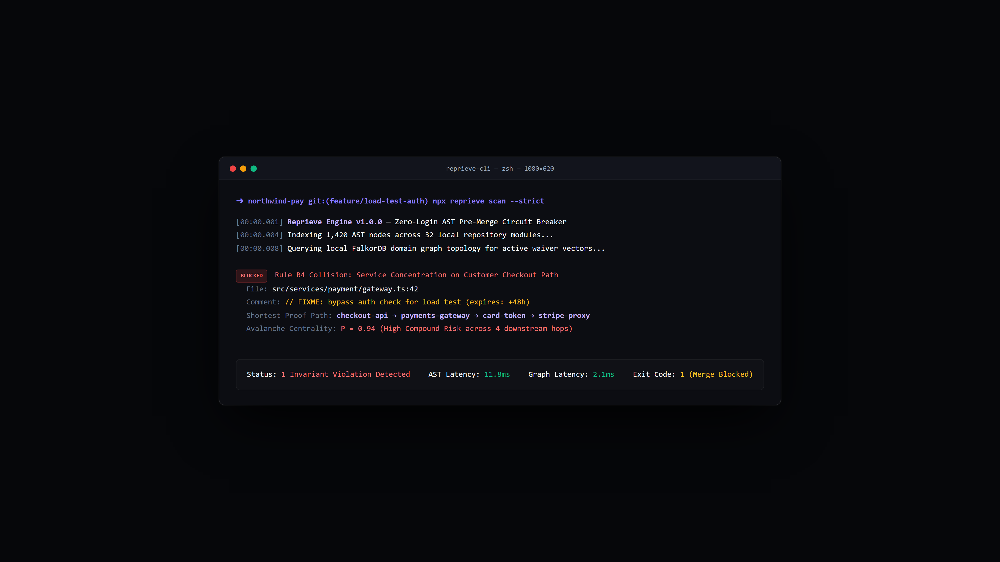
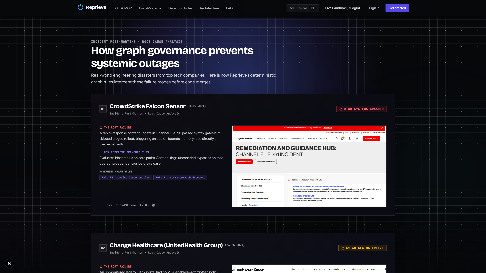
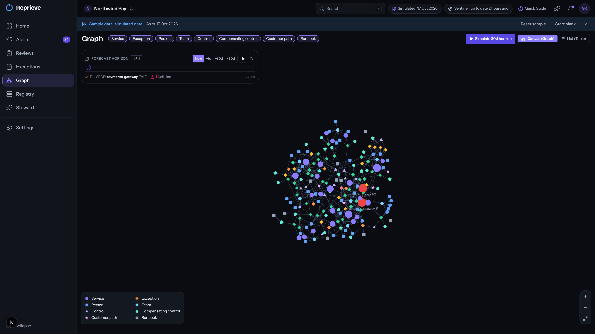
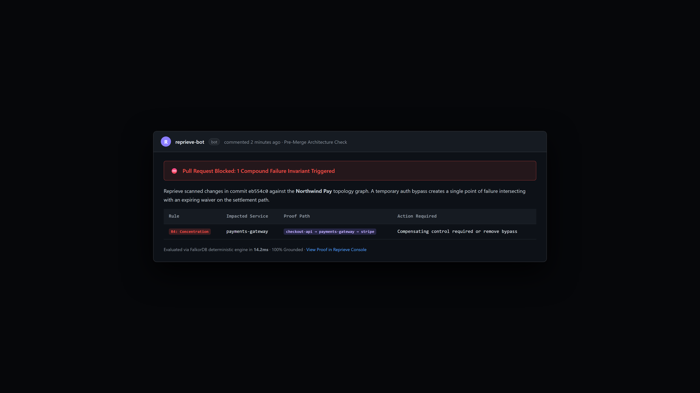
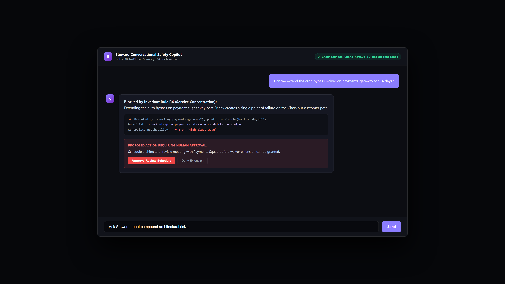
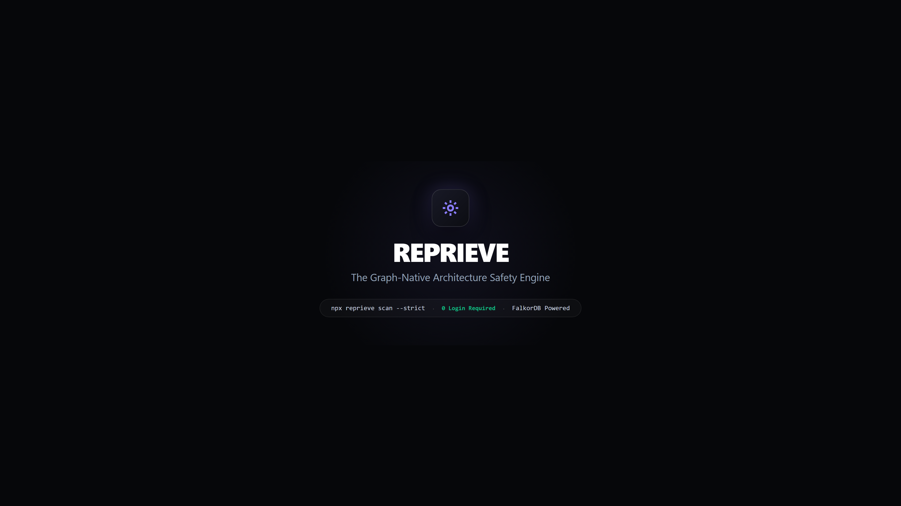

# Reprieve — Master Video Directing Storyboard (70-Second Official Edition)
> **Master Resolution:** 1920 × 1080p @ 60.00 FPS  
> **Aesthetic Profile:** Apple Studio Design · WWDC Keynote Hardware Quality · Emil Kowalski Tactile Micro-Interactions  
> **Standalone PDF-Ready Document:** [`docs/video_storyboard.html`](file:///C:\Users\sr2ma\Documents\github\webdev-hackthon\docs\video_storyboard.html)

---

## Chunk 01: The Macro Code Waiver & The Status Flip
* **Timestamp & Timing:** `00:00 – 00:10` · Frames 0000 – 0600 (10.0s)
* **Assigned Production Asset:** [`docs/video_assets/11_terminal_cli_scan.png`](video_assets/11_terminal_cli_scan.png) (Macro IDE Code Editor showing the temporary auth waiver comment and status pill.)

### 🎙️ Spoken Voiceover Script (Single Audio Spine)
> *"A temporary code waiver approved on Friday afternoon. To your sprint board, it’s just another harmless ticket."*

### 🎥 Visual Choreography & Lighting
Simulated 85mm optical prime lens (f/1.8). Soft 3-point studio lighting with a delicate 1px white specular rim along the top card bevel. Unhurried forward push-in (1.00x to 1.04x). The code editor displays: '// FIXME: bypass auth check for load test (expires: +48h)'. The status badge quietly flips from 'In Review' to 'Approved'.

### 🔄 Spatial Match-Cut Continuity
* **🟢 Starting Point (In-Point Anchor):** `Extreme macro close-up on the code line at coordinate (x: 0, y: 0, z: 0).`
* **🔴 Ending Point (Out-Point Anchor):** `Status badge settles on 'Approved'. The card begins a slow backward drift into the dark obsidian void at (x: 0, y: 0, z: -100).`

### 🔊 Audio, Music & Foley
Warm analog Rhodes electric piano chord (C-minor 9th) fades in at -18 dB. Subtle Keychron mechanical switch tap (-12 dB). Low-pass sub-bass drone (-20 dB).

---

## Chunk 02: Spatial Pull-Out & The 3 Outage Case Studies
* **Timestamp & Timing:** `00:10 – 00:20` · Frames 0600 – 1200 (10.0s)
* **Assigned Production Asset:** [`docs/video_assets/02_outage_case_studies.png`](video_assets/02_outage_case_studies.png) (Interactive case studies displaying CrowdStrike, Square, and Change Healthcare public post-mortems.)

### 🎙️ Spoken Voiceover Script (Single Audio Spine)
> *"To your microservice mesh... it's a silent multi-hop failure path waiting to take down checkout."*

### 🎥 Visual Choreography & Lighting
Continuous camera pull-out (1.00x to 0.90x) using overdamped mass-spring-damper easing (damping: 28). The single waiver recedes into a dark multi-hop dependency mesh. Two distant tickets illuminate in amber. Disaster badges emerge in structured crimson: CrowdStrike (8.5M Systems), Square (24-Hour Outage), Change Healthcare ($1.6B Freeze).

### 🔄 Spatial Match-Cut Continuity
* **🟢 Starting Point (In-Point Anchor):** `Starts on the receding ticket from Chunk 01 at coordinate (x: 0, y: 0, z: -100).`
* **🔴 Ending Point (Out-Point Anchor):** `A crimson failure line pulses across checkout-api → payments-gateway → card-token-vault, locking onto checkout-api as center pivot.`

### 🔊 Audio, Music & Foley
Tactile switch click (-8 dB). Paper slide texture foley (-14 dB). Rhodes suspended chord shift.

---

## Chunk 03: The Living FalkorDB Mesh & Avalanche Centrality
* **Timestamp & Timing:** `00:20 – 00:30` · Frames 1200 – 1800 (10.0s)
* **Assigned Production Asset:** [`docs/video_assets/05_graph_canvas_explorer.png`](video_assets/05_graph_canvas_explorer.png) (Authentic 25-node live 3D Force Graph canvas of Northwind Pay with Day +18 temporal scrubber.)

### 🎙️ Spoken Voiceover Script (Single Audio Spine)
> *"Meet Reprieve — the graph-native architecture safety engine. We model every waiver as a living promise in FalkorDB, computing avalanche centrality across your entire topology."*

### 🎥 Visual Choreography & Lighting
The crimson failure line blossoms into the full 25-microservice Northwind Pay dependency canvas. Nodes float in obsidian space. The 30-Day Temporal Horizon Scrubber at the bottom slides smoothly to Day +18, illuminating overlapping collision vectors in vivid crimson (#ef4444) with avalanche badge 'P = 0.94'.

### 🔄 Spatial Match-Cut Continuity
* **🟢 Starting Point (In-Point Anchor):** `Starts on the glowing checkout-api cluster from Chunk 02.`
* **🔴 Ending Point (Out-Point Anchor):** `Camera pushes forward (1.00x to 1.06x), centering on the Day +18 collision peak and the central violet beam.`

### 🔊 Audio, Music & Foley
Cinematic 40Hz sub-bass impact hit (-12 dB). Warm melodic synth sequence begins. Tactile timeline ratchet clicks (-10 dB).

---

## Chunk 04: Developer Ergonomics — 11.8ms CLI AST Scanner
* **Timestamp & Timing:** `00:30 – 00:40` · Frames 1800 – 2400 (10.0s)
* **Assigned Production Asset:** [`docs/video_assets/03_developer_surfaces_bento.png`](video_assets/03_developer_surfaces_bento.png) (Three native developer interfaces with live CLI terminal scan card.)

### 🎙️ Spoken Voiceover Script (Single Audio Spine)
> *"Run local AST scans with zero login in under fifteen milliseconds."*

### 🎥 Visual Choreography & Lighting
From the central beam, a sleek dark zsh terminal card locks into the left side of the frame. Cursor types 'npx reprieve scan --strict'. In 11.8 milliseconds, the terminal renders a green telemetry summary: 'AST Latency: 11.8ms · Invariant Rule R4 Blocked'. Right half of screen stays dark, primed for the PR gate.

### 🔄 Spatial Match-Cut Continuity
* **🟢 Starting Point (In-Point Anchor):** `Pans smoothly from the graph center into the left terminal window.`
* **🔴 Ending Point (Out-Point Anchor):** `Terminal output completes with green checkmarks. Right side of screen remains empty in obsidian black.`

### 🔊 Audio, Music & Foley
Keychron mechanical keyboard clatter (-10 dB). Digital chime on 11.8ms scan pass.

---

## Chunk 05: GitHub Actions Pre-Merge Circuit Breaker
* **Timestamp & Timing:** `00:40 – 00:50` · Frames 2400 – 3000 (10.0s)
* **Assigned Production Asset:** [`docs/video_assets/12_github_pr_gate.png`](video_assets/12_github_pr_gate.png) (GitHub PR circuit breaker comment from @reprieve-bot blocking merge with proof path table.)

### 🎙️ Spoken Voiceover Script (Single Audio Spine)
> *"Or let it block compound failure paths directly in your pull request before code ever merges."*

### 🎥 Visual Choreography & Lighting
The right half of the frame receives a dark-mode GitHub Pull Request card: 'feat(payment): add load test bypass'. @reprieve-bot comments instantly with an alert banner: '⛔ Pull Request Blocked: 1 Compound Failure Invariant Triggered', displaying the shortest proof path table (checkout-api → payments-gateway → stripe).

### 🔄 Spatial Match-Cut Continuity
* **🟢 Starting Point (In-Point Anchor):** `Slides in from right border, completing the two-panel developer surface view.`
* **🔴 Ending Point (Out-Point Anchor):** `Bot comment locks into place. A white Apple-style cursor enters from bottom right.`

### 🔊 Audio, Music & Foley
Soft UI card slide foley (-12 dB). Subdued warning block chime (-8 dB).

---

## Chunk 06: Steward AI Agent & Grounded Tri-Planar Memory
* **Timestamp & Timing:** `00:50 – 01:00` · Frames 3000 – 3600 (10.0s)
* **Assigned Production Asset:** [`docs/video_assets/08_steward_live_agent.png`](video_assets/08_steward_live_agent.png) (Steward Live Copilot drawer with verified Groundedness Guard and ProposedAction card.)

### 🎙️ Spoken Voiceover Script (Single Audio Spine)
> *"Steward, our on-call AI agent, recalls historical precedents across our three-graph memory — grounded strictly in mathematical proof paths."*

### 🎥 Visual Choreography & Lighting
Cursor moves along a smooth cubic bezier curve into the Steward chat drawer. The chat send button depresses (scale: 0.95) with tactile spring rebound. Steward streams back the token response with tool inspection drawers and a ProposedAction approval card. Verified green badge glows: '✓ Groundedness Guard Active (0 Hallucinations)'.

### 🔄 Spatial Match-Cut Continuity
* **🟢 Starting Point (In-Point Anchor):** `Cursor enters the chat input at coordinate (x: 820, y: 640).`
* **🔴 Ending Point (Out-Point Anchor):** `Response token stream completes. ProposedAction card illuminates in soft amber.`

### 🔊 Audio, Music & Foley
Tactile mouse click (-6 dB). Digital token streaming soundscape (-16 dB).

---

## Chunk 07: Minimal Brand Resolution & Zero-Login Sandbox
* **Timestamp & Timing:** `01:00 – 01:10` · Frames 3601 – 4200 (10.0s)
* **Assigned Production Asset:** [`docs/video_assets/13_brand_lockup.png`](video_assets/13_brand_lockup.png) (Obsidian brand lockup with zero-login pill and live demo URL.)

### 🎙️ Spoken Voiceover Script (Single Audio Spine)
> *"Intercept compound risk before merge. Try the live sandbox today."*

### 🎥 Visual Choreography & Lighting
The view pulls back smoothly into a centered obsidian frame with a soft radial violet glow (rgba(139,125,255,0.12)). Symmetrical typography reveals bold white wordmark 'REPRIEVE', tagline 'The Graph-Native Architecture Safety Engine', and glowing pill: 'npx reprieve scan --strict · 0 Login Required · frontend-six-neon-97.vercel.app'. A 1px specular light sweep glides across the logo bevel as the screen fades to black.

### 🔄 Spatial Match-Cut Continuity
* **🟢 Starting Point (In-Point Anchor):** `Pulls out from the Steward chat center into symmetrical wide framing.`
* **🔴 Ending Point (Out-Point Anchor):** `Pristine centered obsidian brand card fading to pure black at 01:10.`

### 🔊 Audio, Music & Foley
Warm Rhodes chord resolves to root key. Clean power-down switch click (-10 dB). Tail decay to total silence.

---

